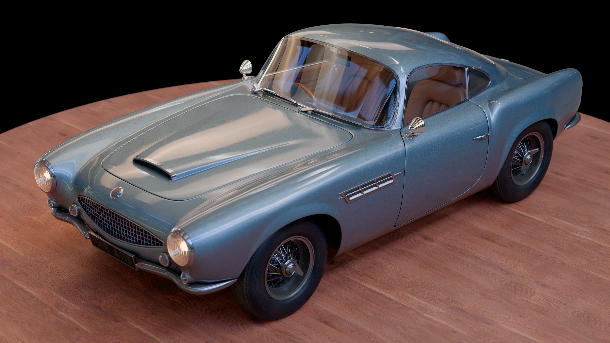
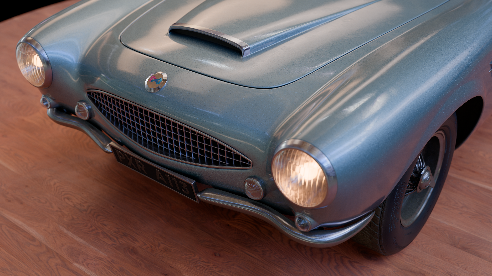
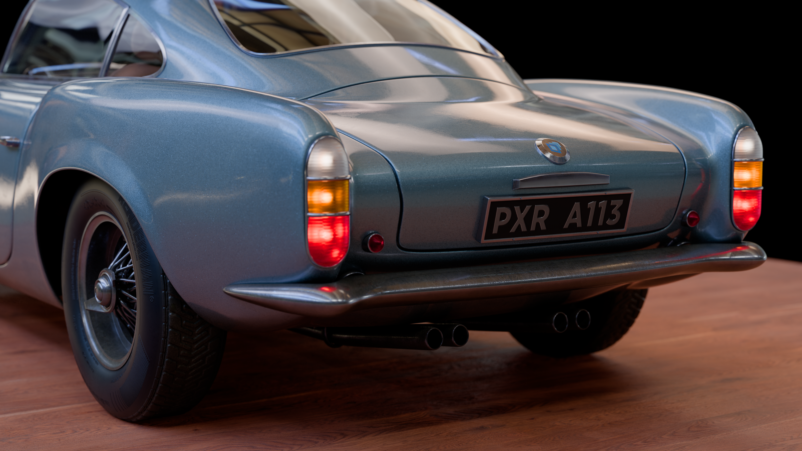
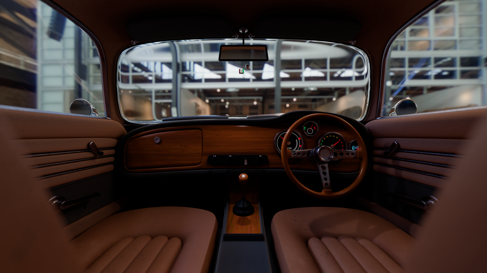
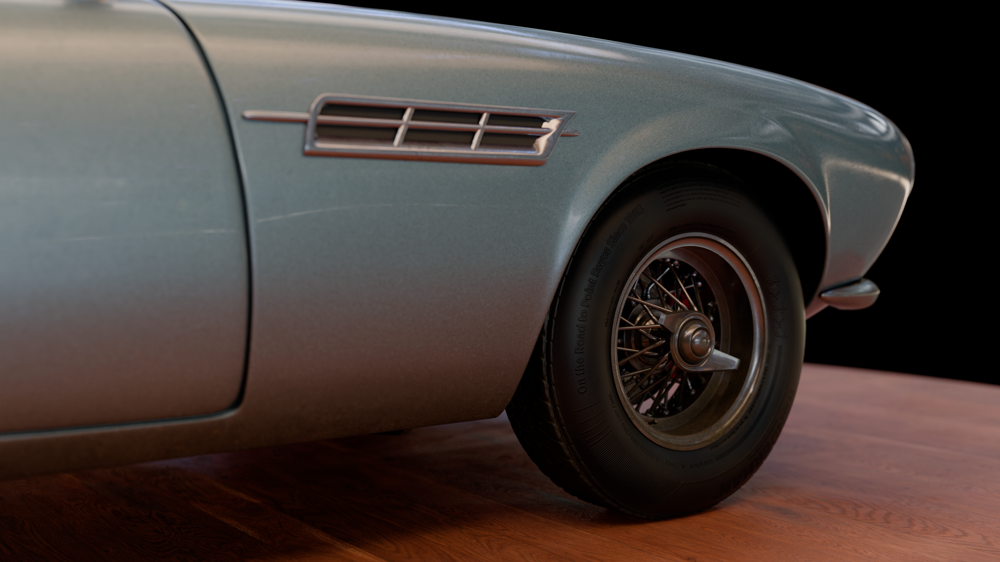
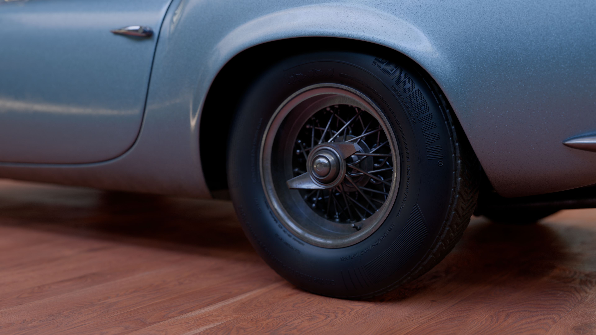
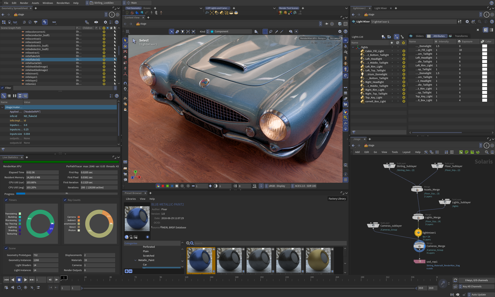

# Stirling
Stirling is an official Pixar asset derived from the Finn McMissile character in Pixar's *Cars 2* and designed to showcase MaterialX. The asset was authored using MaterialX 1.39 base building blocks and does not use monolithic materials such as Standard Surface and OpenPBR.  

	
	
	
	
	
	

  
Stirling comes in three openUSD variants:

Real Time: 
- Polys - High res mesh
- PNG raster textures
- sRGB color space
- 2K max resolution
- Games | Web | Mobile

Offline:
- SubD - Low res mesh
- TEX Mipmap textures
- OCIO Aces color space
- 4K max resolution
- Production rendering

RenderMan:
- SubD - Low res mesh
- TEX Mipmap textures in RenderMan format
- OCIO Aces color space
- 4K max resolution
- Production rendering

  
Stirling running in Houdini 22 and RenderMan 28:

  
##Trivia 
Stirling also has some fun RenderMan historical trivia:

* A113 \- Tag (Number of the classroom at CalArts where many legendary Disney, Pixar, and indie animators studied)  
* Utah Teapot \- Rearview mirror prop (famous open source testing model from University of Utah)  
* Cornell Box \- Rearview mirror prop (inspired by the famous test scene and redone with primitive geometry)  
* MaterialX logo  
* OpenUSD Logo  
* 001988 \- Dashboard Mileage \- RenderMan RiSpec publishing year  
* RenderMan Tires \- Assorted RenderMan trivia on the tire sidewall  

##About the Authors  
Stirling is an initiative by Pixar's Dylan Sisson and modeled by Andrew Schmidt. MaterialX Stirling was created by Pixar's Leif Pedersen and in collaboration with Pixar's Fran Gonzalez and Jonathan Stone from Lucasfilm.  
A special thanks to the technical direction and contributions of Arnon Marcus from OTOY.
